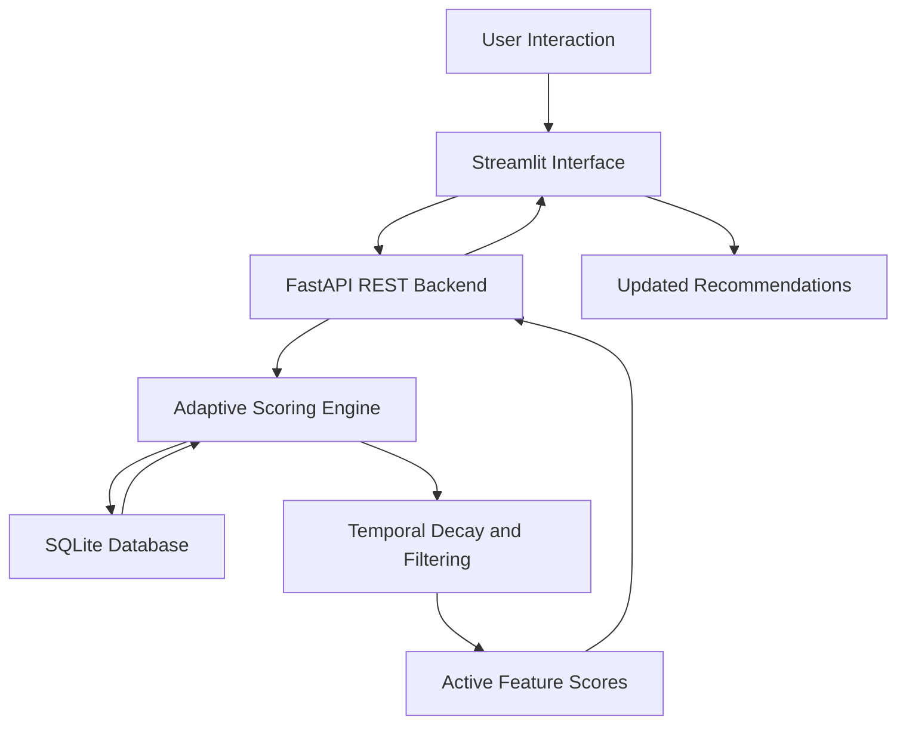

### An Adaptive, Behavior-Driven Framework for Personal Data Relevance and Expiry

ABDEE is a prototype system designed to manage the relevance and lifecycle of user-associated features through **behavioral feedback, dynamic scoring, and time-based decay**. Instead of treating all stored preferences as permanently relevant, the system adjusts feature scores according to user interactions and reduces the influence of older or less relevant information over time.

The project demonstrates this approach through a personalized content recommendation interface called **PandaStream**, where user interactions influence future recommendations.

## Overview

Traditional recommendation systems can continue prioritizing historical preferences even when a user's interests change. ABDEE explores an adaptive alternative in which feature relevance is continuously updated using interaction signals and temporal decay.

The system combines a REST API, persistent SQLite storage, an adaptive scoring mechanism, and a Streamlit-based interface to demonstrate personalized relevance management.

## Key Features

- **Adaptive Relevance Scoring:** Updates feature scores based on user activity and feedback.
- **Time-Based Decay:** Reduces the influence of older feature interactions using exponential decay.
- **Behavioral Feedback Loop:** Positive engagement reinforces a feature, while negative feedback reduces its score and can accelerate decay.
- **Cross-Feature Suppression:** New interactions can reduce the scores of competing features.
- **Active Feature Filtering:** Filters features using configurable relevance and freshness conditions.
- **REST API:** Exposes endpoints for recording interactions, processing feedback, and retrieving active features.
- **Interactive Demonstration:** Provides a Streamlit interface for exploring recommendations and submitting feedback.
- **Persistent Storage:** Stores user-feature states in an SQLite database.

## System Architecture



### How It Works

1. **Interaction Capture:** The application records user actions, such as liking or passing on a content category.
2. **Score Initialization:** A new user-feature combination receives an initial relevance score.
3. **Score Reinforcement:** Repeated engagement increases the corresponding feature score.
4. **Feedback Adaptation:** Explicit feedback modifies the score and decay multiplier.
5. **Temporal Decay:** The system calculates a decayed score based on elapsed time.
6. **Active Feature Selection:** Features are filtered by their score and recency.
7. **Recommendation Display:** The interface retrieves active features and displays the highest-scoring results.

## Technology Stack

| Technology | Purpose |
|---|---|
| Python | Core implementation and scoring logic |
| FastAPI | REST API and backend services |
| SQLite | Persistent user-feature state storage |
| NumPy | Mathematical operations and exponential decay |
| Pydantic | API request data validation |
| Streamlit | Interactive user interface |
| Requests | Communication between the UI and backend |
| Pandas and Altair | Data handling and visualization dependencies |

## Project Structure

```text
ADE-Project-/
├── main.py              # FastAPI backend and scoring logic
├── streaming_app.py     # PandaStream recommendation interface
├── dashboard.py         # Dashboard interface
├── requirements.txt     # Python dependencies
├── abdee.db             # SQLite database
├── Project Screenshots.pdf
├── Review 1.pptx
└── Review 2.pptx
```

The SQLite database is initialized by the backend when it starts. The `abdee.db` file is included in the repository as a project artifact; runtime state may change as interactions are recorded.

## Getting Started

### Prerequisites

- Python 3.10 or later recommended
- pip
- A terminal or command prompt

### 1. Clone the Repository

```bash
git clone https://github.com/N-Sushank-S-N/ADE-Project-.git
cd ADE-Project-
```

### 2. Create a Virtual Environment

**Windows (PowerShell)**

```powershell
python -m venv venv
.\venv\Scripts\Activate.ps1
```

**macOS / Linux**

```bash
python3 -m venv venv
source venv/bin/activate
```

### 3. Install Dependencies

```bash
python -m pip install --upgrade pip
pip install -r requirements.txt
```

### 4. Start the Backend

Open a terminal in the project directory and run:

```bash
uvicorn main:app --reload
```

The FastAPI service should be available at:

- API base URL: `http://127.0.0.1:8000`
- Interactive API documentation: `http://127.0.0.1:8000/docs`

Keep this terminal running.

### 5. Launch the Recommendation Interface

Open a second terminal, activate the same virtual environment, and execute:

```bash
streamlit run streaming_app.py
```

Streamlit will provide a local URL, usually `http://localhost:8501`.

Open that URL in your browser to interact with PandaStream.

### 6. Launch the Dashboard (Optional)

To run the separate dashboard interface:

```bash
streamlit run dashboard.py
```

Use a separate terminal if the recommendation interface is already running.

> **Note:** The dashboard and streaming interface are separate entry points. Verify that any backend service they depend on is running before using their features.

## API Reference

The backend exposes the following endpoints.

| Method | Endpoint | Description |
|---|---|---|
| GET | `/active_features?user_id=<id>` | Retrieves active features for a user |
| POST | `/add_event` | Records an interaction and updates feature scores |
| POST | `/feedback` | Processes engagement or ignore feedback |

### Example: Record an Interaction

```http
POST /add_event
Content-Type: application/json
```

```json
{
  "user_id": "user_001",
  "feature_id": "sci_fi_movies",
  "weight": 1.0
}
```

### Example: Submit Feedback

```http
POST /feedback
Content-Type: application/json
```

```json
{
  "user_id": "user_001",
  "feature_id": "sci_fi_movies",
  "action": "engage"
}
```

For negative feedback, use `"action": "ignore"`.

### Example: Retrieve Active Features

```http
GET /active_features?user_id=user_001
```

The response includes the user identifier and a list of active features with their calculated scores, timestamps, activity density, and decay multipliers.

## Adaptive Scoring Mechanism

ABDEE uses an exponential decay function to calculate a feature's current relevance.

\[
S(t)=S_0e^{-\lambda_{\mathrm{eff}}(t-t_0)}
\]

Where:

- \(S_0\) is the stored feature score.
- \(t_0\) is the last-update timestamp.
- \(t\) is the current timestamp.
- \(\lambda_{\mathrm{eff}}\) is the effective decay rate.

In the current implementation:

\[
\lambda_{\mathrm{eff}}=\lambda_0m
\]

Here, \(\lambda_0\) is the base decay rate and \(m\) is the stored decay multiplier.

### Example 1: Positive Engagement

When a user repeatedly interacts with a content category, the system reinforces its score, making it more likely to remain among the active features.

### Example 2: Ignored Content

When a user ignores a previously tracked feature, its score decreases and its decay multiplier increases, causing its influence to decline more quickly.

These examples illustrate the current scoring rules; they do not imply that the system uses a trained machine-learning model.

## Applications

Potential applications of the underlying approach include:

- Personalized content recommendation.
- Adaptive user preference management.
- Relevance-aware retention of user-associated features.
- Context-sensitive ranking and personalization.
- Research into time-aware data lifecycle management.

## Screenshots

Login Page ABDEE:


DashBoard ABDEE:


Login Page PandaStream:


Dashboard for PandaStream: 


## Current Scope and Limitations

ABDEE is a prototype for adaptive feature relevance and expiry-oriented scoring.

- The current implementation uses rule-based scoring and mathematical decay rather than a trained ML model.
- The active-feature endpoint applies a minimum score threshold and a seven-day freshness condition.
- The current implementation does not automatically delete expired records or enforce a complete personal-data retention policy.
- The demonstration uses a predefined content catalogue rather than a production streaming service.
- Authentication, production deployment, automated testing, and stronger data-protection controls require further development.

**Important distinction:** A feature becoming inactive is not the same as the underlying personal data being deleted. Actual data expiry would require an explicit retention and deletion mechanism.

## Future Enhancements

- Implement automated expiry and deletion workflows.
- Add configurable retention policies for different data categories.
- Introduce user authentication and access controls.
- Build richer analytics for score evolution and user activity.
- Add automated tests for API endpoints and scoring behavior.
- Evaluate adaptive scoring against baseline recommendation strategies.
- Improve auditability and transparency of feature lifecycle decisions.

## Contributing

Contributions and suggestions are welcome. To propose an improvement, fork the repository, create a feature branch, test your changes, and submit a pull request.

## License

No license is currently specified in this README. Add an appropriate `LICENSE` file before explicitly granting others permission to reuse or distribute the project.

---

**Developed as a project on adaptive, behavior-driven feature relevance and expiry-oriented data management.**

Repository: [N-Sushank-S-N/ADE-Project-](https://github.com/N-Sushank-S-N/ADE-Project-)
